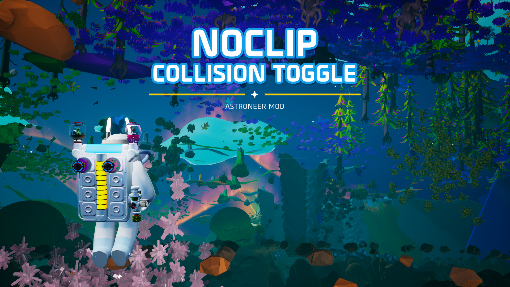
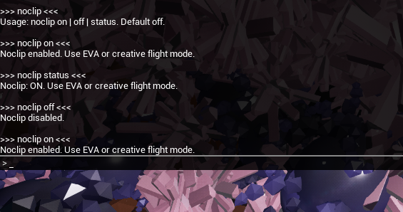

# 👻 Noclip Collision Toggle 1.1.0 👻

Fly through terrain! Easy console-command toggle to pass through terrain & objects during flight mode without being ejected, while also preventing wonky camera adjustments/repositioning.

Impacts collision only while in EVA or creative flight mode.

## Install

- **(RECOMMENDED)** Install with [Nexus Mods Vortex](https://www.nexusmods.com/vortex), which automatically installs required extensions for Astroneer mods.
- Manual installation:
    1. Download the latest [UE4SS experimental .zip file](https://github.com/UE4SS-RE/RE-UE4SS/releases/tag/experimental-latest) (scroll to the bottom under assets).
    2. In Steam, right-click Astroneer → Manage → Browse local files. Open `Astro\Binaries\Win64`.
    3. Extract the UE4SS .zip content into `Astro\Binaries\Win64`.
    4. Extract `Noclip-Collision-Toggle-#.#.#-UE4SS.zip` into `Astro\Binaries\Win64\ue4ss\Mods`.
    5. The folder structure should look something like this: `ASTRONEER\Astro\Binaries\Win64\ue4ss\Mods\NoclipCollisionToggle`.

## Noclip Toggle

Noclip is OFF by default.

> [!NOTE]
> **Use EVA or creative flight mode to pass through terrain.**
> Walking still collides with terrain, even with noclip enabled.

Press F10 (or tilde key) once to open the console input field or twice to see the full console.

Available commands:
```
noclip on
noclip off
noclip status
```


> [!CAUTION]
> If Noclip is switched to OFF while in terrain, or if Noclip is ON and player switches to walk mode while in terrain, expect normal game handling to occur upon which player is ejected upwards until no longer colliding with terrain. Be careful, can cause player fall damage!

Noclip resets to OFF when the game is restarted.

---

Uses [MinHook](https://github.com/TsudaKageyu/minhook). License included.
